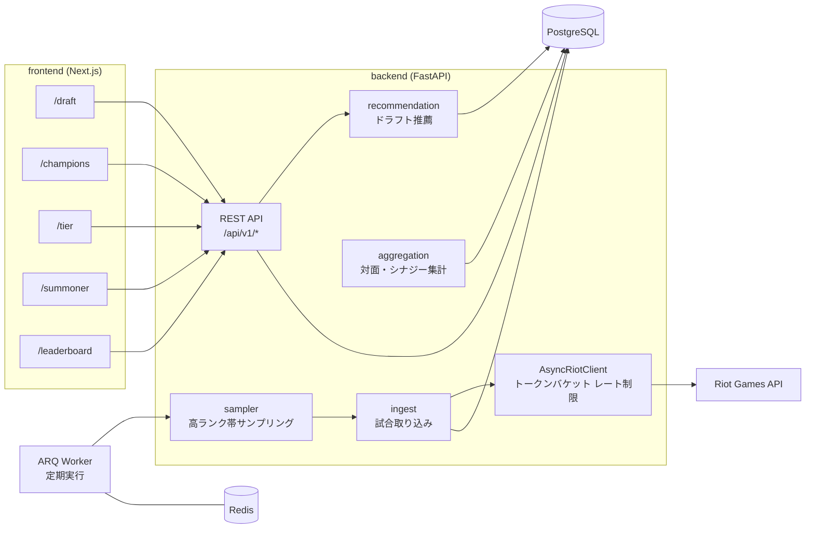

# LoL Coach — League of Legends ドラフト支援ツール

> 本プロジェクトは **Claude Code を用いたAI駆動開発** で設計・実装しました。

Riot Games API から高ランク帯（Challenger / GM / Master）の試合を収集・集計し、ピック段階で「どのチャンピオンを選ぶと有利か」を勝率から提案する Web ツールです。
チャンピオン別の統計、ティアリスト、サモナー検索、ランキングも見られます。

## 構成図



## 技術スタック

| 分類 | 使用技術 |
|---|---|
| バックエンド | Python 3.13, FastAPI, SQLAlchemy 2.0（async）, Alembic, pydantic-settings, httpx, Click（CLI） |
| ジョブキュー | ARQ + Redis |
| DB | PostgreSQL（asyncpg） |
| フロントエンド | Next.js 15（App Router）, React 19, TypeScript, Tailwind CSS v4, TanStack Query, shadcn/ui |
| 開発ツール | uv, Ruff, mypy, pytest, Docker Compose, Makefile |

## 主な機能

- **ドラフト推薦**（`/draft`）：味方・敵のピックを入れると、候補チャンピオンを対面勝率とシナジー勝率の合計スコアで順位付け
- **チャンピオン一覧・詳細**、**ティアリスト**
- **サモナー検索**：ランク、最近の試合、チャンピオン別成績
- **ランキング**：リージョン別の高ランクプレイヤー
- **高ランク帯の試合収集**：CLI（`lol-coach ingest sample`）または ARQ で定期実行

## 工夫した点

- **サンプル数を考慮したスコアリング**：試合数の少ない組み合わせの勝率を 0.5 側へ縮小して、偶然の高勝率に引っ張られないようにした
- **Riot API の複数レート制限に対応**：アプリ単位の複数ウィンドウ（例：20回/1秒、100回/120秒）をトークンバケットで表現し、すべてに空きがあるときだけリクエストする
- **事前同期なしで取り込み可能**：チャンピオン・パッチ情報を試合データから upsert するので、Data Dragon の同期処理を待たずに収集を始められる
- **集計は「全再計算」から始める**：TRUNCATE + 一括 INSERT のシンプルな実装にし、件数が増えたら差分更新（`matches.aggregated_at`）へ移行できる設計にした
- **型と品質チェック**：`make check` で Ruff・mypy・pytest をまとめて実行

## セットアップ

必要なもの：Python 3.13+, [uv](https://github.com/astral-sh/uv), Docker / Docker Compose, Node.js 20+, Riot API キー

```bash
git clone https://github.com/ten-ten66/lol-coach.git
cd lol-coach

cp .env.example .env              # RIOT_API_KEY / DATABASE_URL / REDIS_URL / POSTGRES_PASSWORD を設定
make up                           # PostgreSQL + Redis 起動
make sync                         # Python 依存関係
make dev                          # API → http://127.0.0.1:8000/api/v1/health

# フロントエンド
cd frontend
cp .env.example .env.local        # NEXT_PUBLIC_API_BASE=http://127.0.0.1:8000
npm install
npm run dev                       # → http://localhost:3000
```

よく使うコマンド：`make help` / `make test` / `make check` / `make down` / `make reset`

詳しい設計は [`docs/DESIGN.md`](docs/DESIGN.md) を参照してください。
